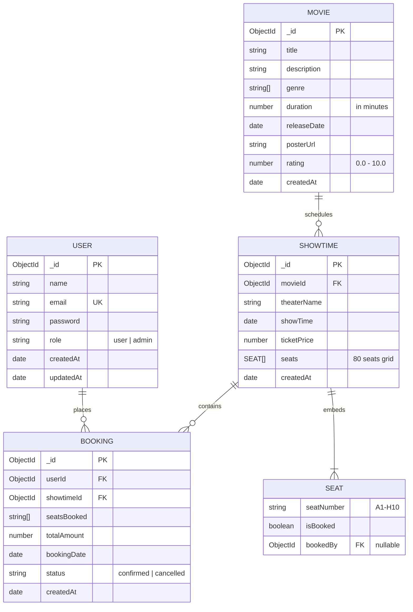

# 🎬 IMovies - Movie Ticket Booking Made Simple

A full-stack, production-grade **MERN** (MongoDB, Express.js, React, Node.js) web application designed for browsing trending blockbusters, inspecting auditoriums, reserving seats via an interactive 80-seat matrix with atomic collision prevention, and managing confirmed cinema bookings.

---

## 📑 Table of Contents
1. [Key Features](#key-features)
2. [Technical Architecture](#technical-architecture)
3. [MVC Architectural Breakdown](#mvc-architectural-breakdown)
4. [Mermaid.js Entity-Relationship (ER) Diagram](#mermaidjs-entity-relationship-er-diagram)
5. [API Endpoints Reference](#api-endpoints-reference)
6. [Directory Structure](#directory-structure)
7. [Getting Started & Local Run Instructions](#getting-started--local-run-instructions)
8. [Demo Credentials](#demo-credentials)

---

## 🌟 Key Features

- **Trending Movie Catalog**: Real-time category/genre filtering (Sci-Fi, Action, Animation, Drama, etc.), instant search, ratings, runtimes, and synopses.
- **Showtime & Theater Selector**: Browse upcoming screenings across various theaters (IMAX, Dolby Atmos, VIP lounges) with real-time ticket pricing.
- **Interactive 8x10 Theater Grid**:
  - 80-seat auditorium layout (Rows A–H, Columns 1–10) with realistic center aisle.
  - Curved cinema screen with immersive glow aesthetics.
  - Three distinct seat states: **Available** (Slate), **Selected** (Emerald Glow), and **Booked** (Muted Red).
  - Dynamic real-time price calculator.
- **Atomic Concurrency & Collision Prevention**:
  - Utilizes atomic MongoDB `findOneAndUpdate` with array filters (`seats.$[elem]`) and `$not: { $elemMatch: { ... isBooked: true } }`.
  - Guarantees zero race conditions or overbooking during concurrent user checkouts.
- **JWT Authentication & RBAC**:
  - Secure password hashing using `bcryptjs` (salt rounds: 10).
  - Role-Based Access Control (`user` vs `admin`).
  - Axios request interceptor automatically attaches bearer tokens from `localStorage`.
- **My Bookings Dashboard**:
  - Inspect confirmed reservations, auditorium info, seat numbers, and transaction totals.
  - Includes real-time cancellation action that atomically releases seats back to the public pool.
- **Admin Movie Management**: Dedicated dashboard enabling admins to publish new movie titles.

---

## 🏗 Technical Architecture

```
                                  ┌─────────────────────────────┐
                                  │      Client (React+Vite)     │
                                  │   - React Router DOM v6     │
                                  │   - Bootstrap 5 + Dark Mode │
                                  │   - Axios Auth Interceptor  │
                                  └──────────────┬──────────────┘
                                                 │ HTTP / JSON
                                                 │ Authorization: Bearer <JWT>
                                                 ▼
                                  ┌─────────────────────────────┐
                                  │    Node.js / Express API    │
                                  │   - CORS, Body Parsers      │
                                  │   - verifyToken & isAdmin   │
                                  └──────────────┬──────────────┘
                                                 │
                   ┌─────────────────────────────┼─────────────────────────────┐
                   ▼                             ▼                             ▼
        ┌─────────────────────┐       ┌─────────────────────┐       ┌─────────────────────┐
        │   Auth Controller   │       │   Movie/Showtime    │       │  Booking Controller │
        │  Register / Login   │       │    Controllers      │       │ Atomic Lock & Check │
        └──────────┬──────────┘       └──────────┬──────────┘       └──────────┬──────────┘
                   │                             │                             │
                   └─────────────────────────────┼─────────────────────────────┘
                                                 │ Mongoose ODM
                                                 ▼
                                  ┌─────────────────────────────┐
                                  │     MongoDB (Atlas / Local) │
                                  │   - users                   │
                                  │   - movies                  │
                                  │   - showtimes (80 seats)    │
                                  │   - bookings                │
                                  └─────────────────────────────┘
```

---

## 🏛 MVC Architectural Breakdown

The project follows clean Separation of Concerns adhering strictly to the **Model-View-Controller (MVC)** design pattern:

### 1. Model Layer (`server/models/`)
- Encapsulates domain logic, data schemas, default values, and database integrity constraints.
- **`User.js`**: Enforces unique emails, password hashing via pre-save hooks, and password comparison methods.
- **`Movie.js`**: Stores title, rich descriptions, genres, duration, release dates, poster URLs, and ratings.
- **`Showtime.js`**: References the target `Movie`, records theater venue, show date/time, ticket price, and holds an embedded subdocument array of 80 seats.
- **`Booking.js`**: Stores confirmed reservations, links `userId` and `showtimeId`, records seat codes, total price, and lifecycle status (`confirmed` | `cancelled`).

### 2. View Layer (`client/`)
- Modern Single-Page Application (SPA) driven by **React 18** and **Vite**.
- Component-driven UI using **Bootstrap 5** with custom dark cinema glassmorphism styles.
- State-driven reactivity with **React Context API** (`AuthContext`) for universal authentication state and token persistence.
- Client-side navigation powered by **React Router DOM v6**.

### 3. Controller Layer (`server/controllers/` & `server/routes/`)
- Handles incoming HTTP requests, input validation, status codes, and error formatting.
- **`authController.js`**: Manages registration, credential verification, and JWT generation (30-day expiry).
- **`movieController.js`**: Supports catalog retrieval, genre filtering, regex search, and admin movie publishing.
- **`showtimeController.js`**: Retrieves showtimes by movie ID, outputs full seat matrices with availability counters, and generates 80-seat grids.
- **`bookingController.js`**: Executes pre-flight collision checks and atomic updates via MongoDB `findOneAndUpdate`.

---

## 📊 Mermaid.js Entity-Relationship (ER) Diagram



---

## 🔌 API Endpoints Reference

Base URL: `http://localhost:5000/api`

| Method | Endpoint | Description | Auth Required | Request Body / Params |
| :--- | :--- | :--- | :--- | :--- |
| **POST** | `/auth/register` | Register new user | Public | `{ name, email, password, role? }` |
| **POST** | `/auth/login` | Login and obtain JWT token | Public | `{ email, password }` |
| **GET** | `/auth/me` | Fetch active user profile | Bearer Token | None |
| **GET** | `/movies` | Get all movies (supports `?genre=` & `?search=`) | Public | Query: `genre`, `search` |
| **GET** | `/movies/:id` | Get movie details by ID | Public | Params: `id` |
| **POST** | `/movies` | Add new movie | Admin Only | `{ title, description, genre, duration, releaseDate, posterUrl, rating }` |
| **GET** | `/showtimes` | List all showtimes | Public | Query: `movieId?` |
| **GET** | `/showtimes/movie/:movieId` | Get showtimes for specific movie | Public | Params: `movieId` |
| **GET** | `/showtimes/:id/seats` | Get 80-seat matrix for showtime | Public | Params: `id` |
| **POST** | `/showtimes` | Create new showtime (generates 80 seats) | Admin Only | `{ movieId, theaterName, showTime, ticketPrice }` |
| **POST** | `/bookings` | Reserve seats (atomic update & collision check) | Bearer Token | `{ showtimeId, seatsBooked: ["A1", "A2"] }` |
| **GET** | `/bookings` | Get user's confirmed bookings | Bearer Token | None |
| **PUT** | `/bookings/:id/cancel` | Cancel booking & release seats | Bearer Token | Params: `id` |

---

## 📁 Directory Structure

```
imovies-mern/
├── client/                      # React + Vite Frontend
│   ├── public/
│   ├── src/
│   │   ├── api/
│   │   │   └── axios.js         # Axios instance with baseURL & JWT interceptor
│   │   ├── components/
│   │   │   ├── AuthModal.jsx    # Tabbed Sign In / Register modal with quick-fill
│   │   │   ├── BookingModal.jsx # Booking confirmation & price summary modal
│   │   │   └── Navbar.jsx       # Global responsive navigation header
│   │   ├── context/
│   │   │   └── AuthContext.jsx  # Context provider for user auth state
│   │   ├── pages/
│   │   │   ├── AdminAddMovie.jsx# Admin dashboard to publish new movies
│   │   │   ├── Home.jsx         # Movie catalog, genre filtering & search
│   │   │   ├── MovieDetails.jsx # Movie synopsis & showtime selector
│   │   │   ├── MyBookings.jsx   # User confirmed bookings & cancellation
│   │   │   └── SeatMatrix.jsx   # Interactive 8x10 theater grid with screen glow
│   │   ├── App.jsx              # Application router & layout
│   │   ├── index.css            # Custom cinema dark-mode styling
│   │   └── main.jsx             # React entry point
│   ├── index.html
│   ├── package.json
│   └── vite.config.js
│
├── server/                      # Node.js + Express Backend
│   ├── config/
│   │   └── db.js                # MongoDB connection handler
│   ├── controllers/
│   │   ├── authController.js    # Register, login, getMe
│   │   ├── bookingController.js # Atomic seat locks, collision detection
│   │   ├── movieController.js   # Movie catalog CRUD
│   │   └── showtimeController.js# Showtime & 80-seat matrix handler
│   ├── middleware/
│   │   └── authMiddleware.js    # verifyToken & isAdmin guards
│   ├── models/
│   │   ├── Booking.js           # Reservation schema
│   │   ├── Movie.js             # Movie catalog schema
│   │   ├── Showtime.js          # Showtime & embedded 80-seat schema
│   │   └── User.js              # User auth & bcrypt schema
│   ├── routes/
│   │   ├── authRoutes.js        # /api/auth routes
│   │   ├── bookingRoutes.js     # /api/bookings routes
│   │   ├── movieRoutes.js       # /api/movies routes
│   │   └── showtimeRoutes.js    # /api/showtimes routes
│   ├── .env                     # Local environment file
│   ├── .env.example             # Template environment variables
│   ├── package.json
│   ├── seed.js                  # Database seeder (6 movies + 80-seat grids)
│   └── server.js                # Server entry point
│
└── README.md                    # Project documentation
```

---

## 🚀 Getting Started & Local Run Instructions

### Prerequisites
- [Node.js](https://nodejs.org/) (v18 or higher installed)
- [MongoDB](https://www.mongodb.com/) (either a local instance or a free [MongoDB Atlas](https://www.mongodb.com/atlas) cloud cluster)

---

### Step 1: Configure Backend Environment Variables

Open `server/.env` (or copy from `server/.env.example`):

```bash
# If using MongoDB Atlas:
MONGO_URI=mongodb+srv://<username>:<password>@cluster0.xxxxx.mongodb.net/imovies?retryWrites=true&w=majority

# Or if using local MongoDB:
# MONGO_URI=mongodb://127.0.0.1:27017/imovies

PORT=5000
JWT_SECRET=imovies_super_secret_jwt_key_2026_production
```

---

### Step 2: Seed the Database

Populate 6 trending movies, theaters, showtimes, and an 80-seat grid (Rows A–H, Columns 1–10) for each show:

```bash
cd server
node seed.js
```

---

### Step 3: Start the Backend Server

```bash
cd server
npm run dev
# Server will run on: http://localhost:5000
```

---

### Step 4: Start the Frontend Client

In a separate terminal:

```bash
cd client
npm run dev
# Frontend will run on: http://localhost:5173
```

Now open **`http://localhost:5173`** in your browser!

---

## 🔑 Demo Credentials

For quick evaluation, click the quick-fill buttons in the Sign In modal or use:

| Role | Email | Password | Privileges |
| :--- | :--- | :--- | :--- |
| **Demo Customer** | `demo@imovies.com` | `demopassword123` | Book tickets, view reservations, cancel seats |
| **Admin** | `admin@imovies.com` | `adminpassword123` | Publish new movies, manage cinema catalog |
